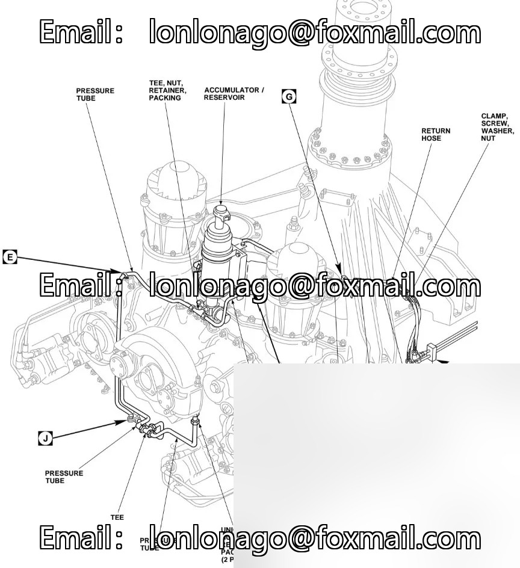
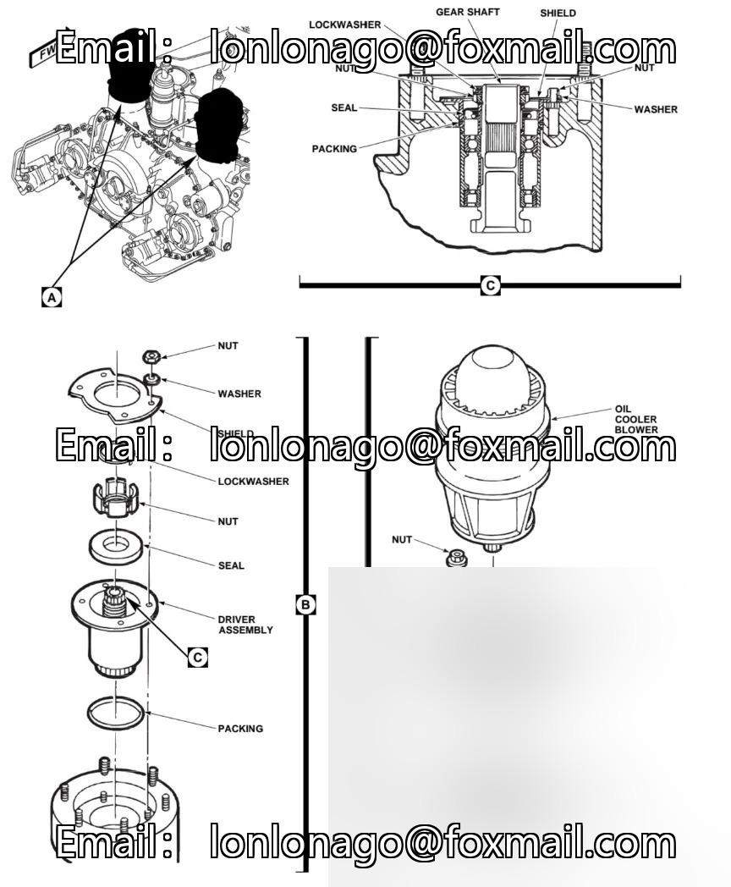
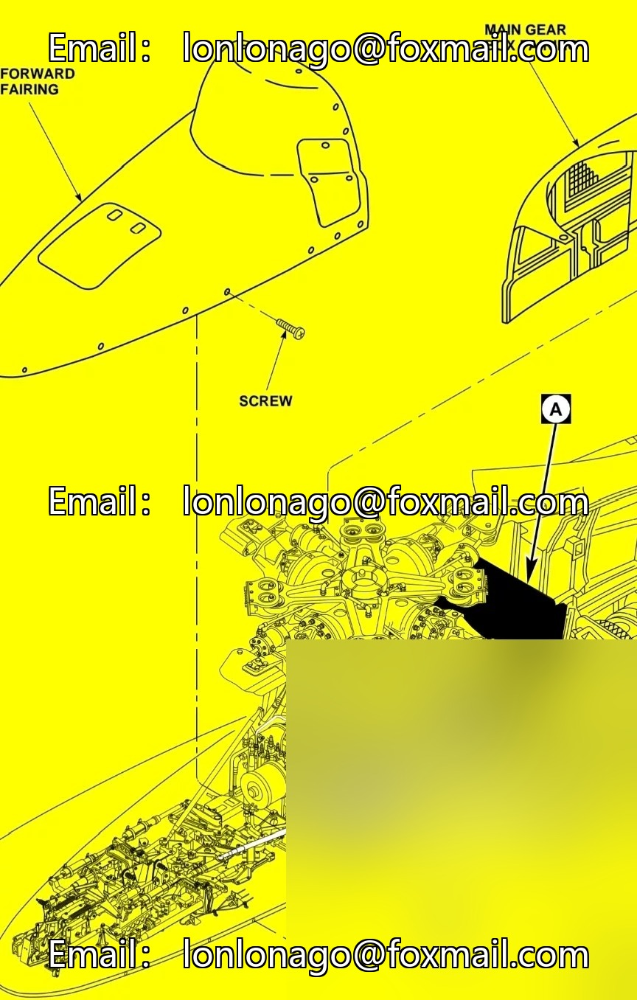
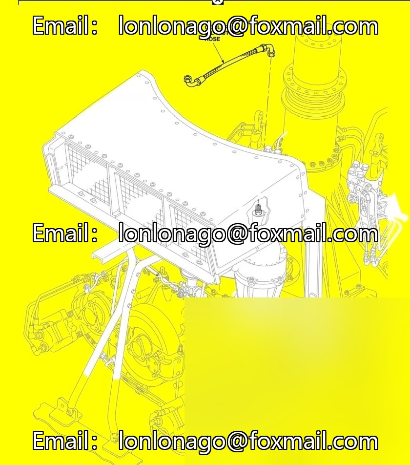
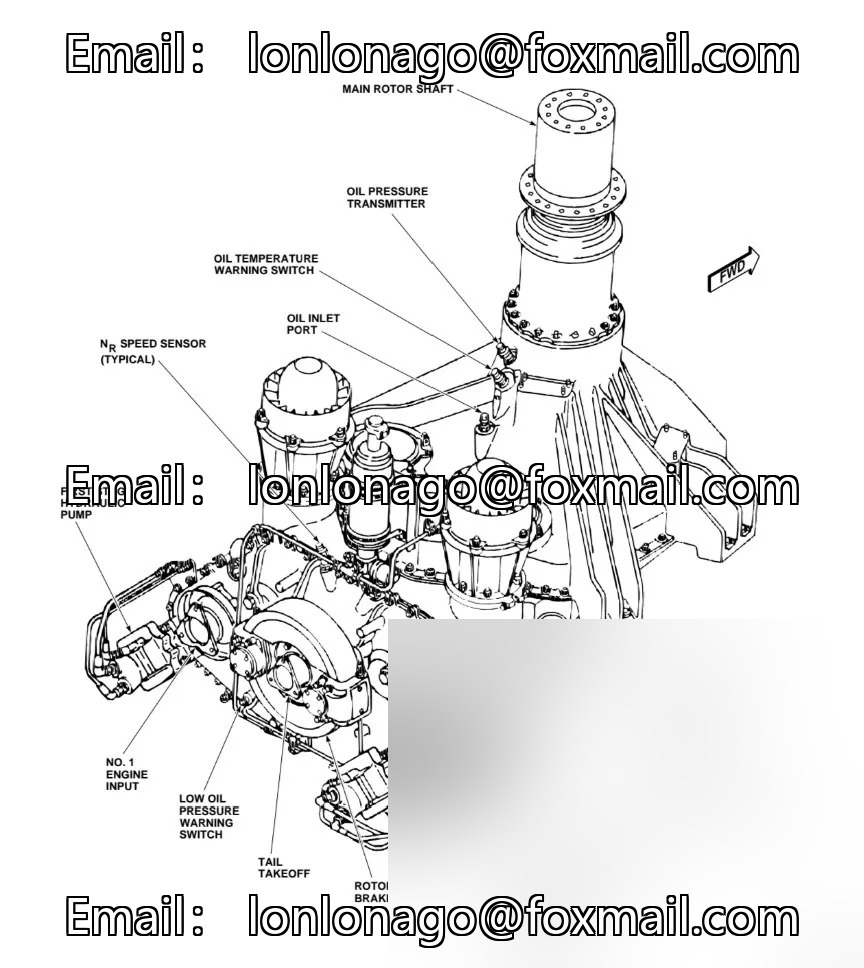
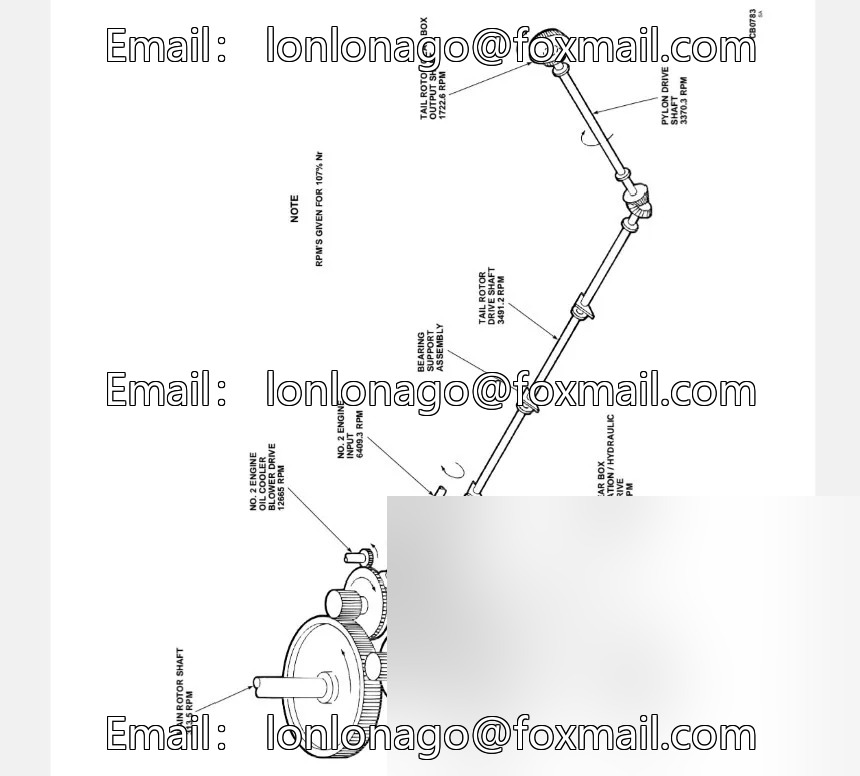

# Sikorsky (S-76B) helicopter maintenance manual (Volume)

## Body

Sikorsky (S-76B) Helicopter Maintenance Manual (Chapter 66)
PDF , 390 pages, chapter number 66, English original version, content covers parts such as main reducer, engine installation frame, main rotor transmission shaft, tail rotor transmission shaft, and oil cooling, lubrication systems, applicable to S-76B twin-engine helicopter.

Export control warning: clearly indicate that the document contains technical data subject to the 《Export Control Regulation》(EAR) and requires authorization prior to providing it to specific countries or entities (involving ECCN 9E991 classification).

are non-returnable or non-changeable after sale

The Sikorsky (Sikorsky) S-76B helicopter maintenance manual chapter 66 is a 390-page English original PDF covering main reducers, engine installation supports, main rotor shaft, tail rotor shaft, oil cooling, lubrication systems, and suitable for S-76B twin-engine helicopters. The images show pressure, oil reservoir, accumulator tube, packing, clamp, screw, hose, nut, gear shaft, oil pressurization, transmitter, oil temperature, warning switch, oil inlet, speed sensor, hydraulic pump, engine, input, low oil warning, braking, LVHS, 31ON, hydraulic pump, etc.

<!-- AI_ENRICHED -->

## Images

## Payment

Here is a pay link on Stripe ( https://buy.stripe.com/3cs8yP7sY87d0vu9AB ). Please contact me lonlonago@foxmail.com after funding $89, and I will send you a complete data files , thank you!

